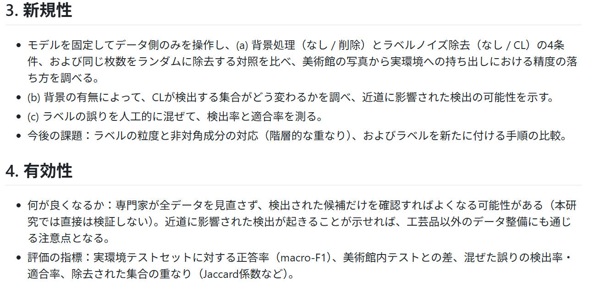
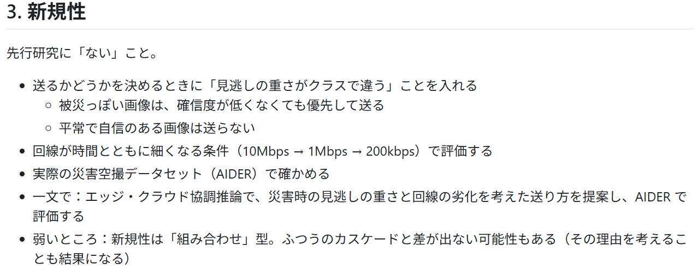
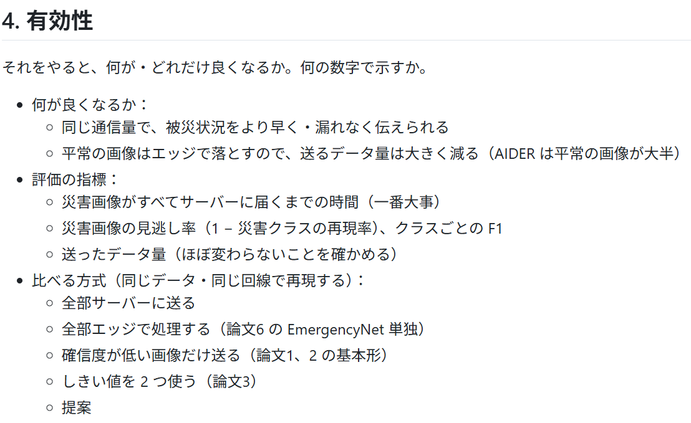
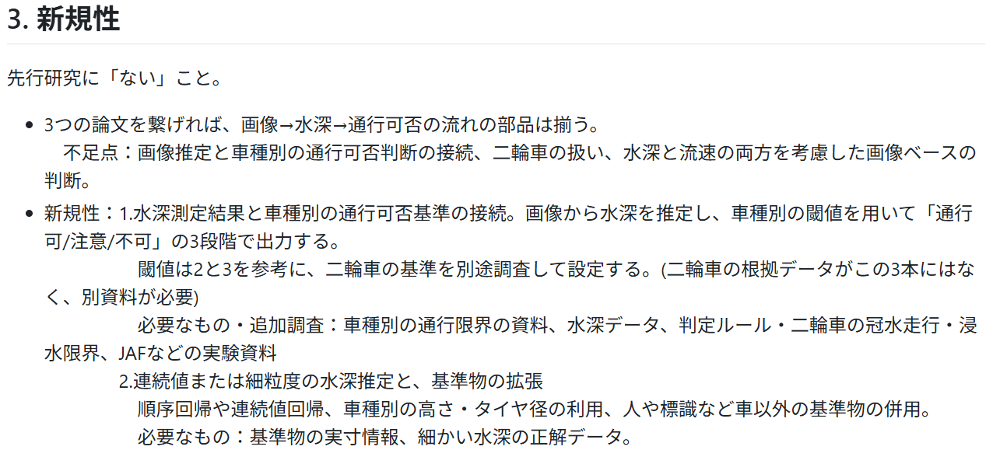
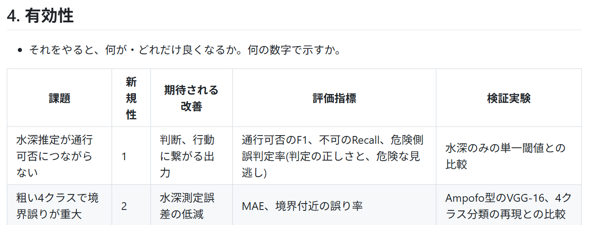

# 上岡研究室3班 ゼミナール活動報告書（第3回）

- 日付:2026年10月15日(木)
- 作成者:塚原陸斗
- 仮研究テーマ:エッジAIの被災度判定を用いた基地局優先送信による災害画像収集の早期化

## 1. 実施内容
- 前半にそれぞれのテーマで調べてきた先行研究を発表し、議論した
- それを元に3つの中から研究テーマを決定した
- その後、研究計画書を作成した

## 2. 実際の進捗内容
### (1) 調べてきた先行研究の発表と議論
- 山重：伝統工芸品のデータ整形とスマホ活用
- 渡部：エッジとサーバーで分担する災害画像の分類
- 塚原：災害時の冠水道路画像を用いた水深推定と車両別の通行可否判定

一人ずつ調べてきた先行研究についての技術的な課題と新規性・有効性について説明した。それぞれの良いところや足りないところ、ミニ研究の期間で終わるかなどを考えながら班で議論した。

### (2) 研究テーマの決定
- 議論の結果、テーマは渡部のエッジとサーバーで分担する災害画像の分類になった。このテーマについて全員が大まかに理解するために内容を確認した
- テーマ名を仮決定し、研究の大まかなスケジュールを決定した
- 研究計画書の作成を進めるために、先行研究の論文を誰がどこをまとめるのかを分担した

## 3. 来週の達成目標（宿題）
- [ ] 来週の「卒研テーマ決定のためのミーティング」に備えて、研究計画書を作成してくる
- [ ] ミニ研究の研究計画書も進めるために、それぞれ割り振った先行研究の論文についてまとめてくる（再来週まで）

## 4. 全体のスケジュール
| 時期 | やること |
| --- | --- |
| 10/15 | 研究テーマ決め。研究計画書の決定（今日） |
| 10/22 | 卒研テーマのミーティング |
| 11/5 | 研究計画書の完成。データやコードの準備 |
| 11/12 | 実装を進めていく |

## 5. 感想
自分が調べてきた先行研究について発表したが、半期でミニ研究をやることを踏まえるとデータセットや新規性など色々問題が発生し、研究テーマ決めの難しさを改めて感じた。また、チーム開発にはGitHubは便利だと感じ、これからも使っていきたいと思った。

## 6. 議事録
それぞれ調べた先行研究の内容について示す。

### 山重
- テーマ：伝統工芸品のデータ整形とスマホ活用（背景の近道とラベルノイズの除去）
- 技術的課題：誤りがクラスのみに依存するという仮定が強い、背景などの近道に沿った誤りは検出されにくい。評価が大規模データ中心など

### 渡部
- テーマ：エッジとサーバーで分担する災害画像の分類（エッジ・クラウド協調推論）
- 技術的課題：どのクラスの間違いも同じ重さで扱う。クラスの優先度を「計算の打ち切り」にしか使っていない。優先度がない。災害の対象・データで評価していない

### 塚原
- テーマ：災害時の冠水道路画像を用いた水深推定と車両別の通行可否判定
- 技術的課題：車高150cm固定、水平切断。水深推定が人手の動画解析

